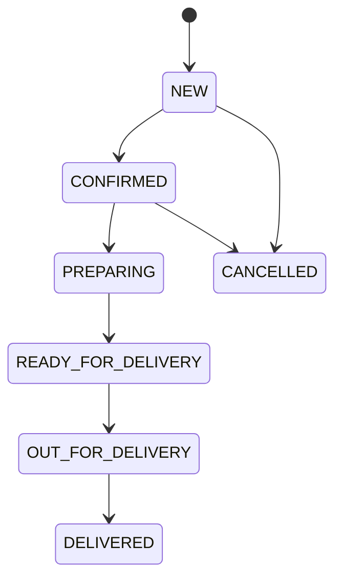

# واجهات API + حالات الطلب

> الهدف من هذا المستند: تحديد ما يجب أن يقدمه السيرفر (Backend) كـ API لدعم تطبيق العميل، تطبيق المطعم، وتطبيق الدليفري.

## مبادئ عامة

- REST API لعمليات CRUD الأساسية.
- Real-time للتحديثات (WebSocket / SSE / Firebase… حسب اختيار التقنية).
- جميع الأوقات UTC + إرجاع `createdAt/updatedAt`.

---

## حالات الطلب (Order Status)

الحالات القياسية المقترحة (قابلة للتعديل):

- `NEW` — طلب جديد
- `CONFIRMED` — تم التأكيد من المطعم
- `PREPARING` — جاري التحضير
- `READY_FOR_DELIVERY` — جاهز للتوصيل
- `OUT_FOR_DELIVERY` — مع المندوب
- `DELIVERED` — تم التسليم
- `CANCELLED` — ملغي

قواعد انتقال الحالة (مختصر):



---

## Endpoints (تصميم مقترح)

### Auth

- `POST /auth/login` — تسجيل دخول (مطعم/مندوب/عميل حسب السياسة)
- `POST /auth/refresh` — تجديد التوكن

### Menu

- `GET /menu/categories`
- `GET /menu/items?categoryId=...`
- `GET /menu/items/{id}`

### Offers / Coupons

- `GET /offers/active`
- `POST /offers/apply` — تطبيق عرض/كوبون على سلة

### Cart / Checkout

- `POST /cart/validate` — تحقق من الأسعار/الإضافات/التوفر
- `POST /orders` — إنشاء طلب

### Orders (Customer)

- `GET /orders/my`
- `GET /orders/{id}`

### Orders (Restaurant)

- `GET /restaurant/orders?status=NEW`
- `POST /restaurant/orders/{id}/confirm`
- `POST /restaurant/orders/{id}/set-status` — نقل الحالة (مثلاً PREPARING)
- `POST /restaurant/orders/{id}/send-to-delivery`

### Delivery

- `GET /delivery/jobs` — الطلبات الجاهزة للتوصيل
- `POST /delivery/jobs/{orderId}/accept`
- `POST /delivery/jobs/{orderId}/picked-up`
- `POST /delivery/jobs/{orderId}/delivered`

---

## Events (Real-time)

أمثلة أحداث لحظية (Channels):

- `order.created` (للمطعم)
- `order.status.changed` (للعميل)
- `order.assigned.to.delivery` (للمندوب)
- `delivery.location.updated` (اختياري في Premium)

Payload مثال:

```json
{
  "event": "order.status.changed",
  "orderId": "ord_123",
  "status": "PREPARING",
  "at": "2026-04-24T10:30:00Z"
}
```

---

## ملاحظات مهمة

- في **Basic**: يمكن الاكتفاء بإشعارات حالة الطلب بدون تتبع GPS.
- في **Pro/Premium**: Real-time أساسي لتجربة “لحظياً”.
- الأسعار النهائية يجب أن تُحسب على السيرفر (Server authoritative pricing).
