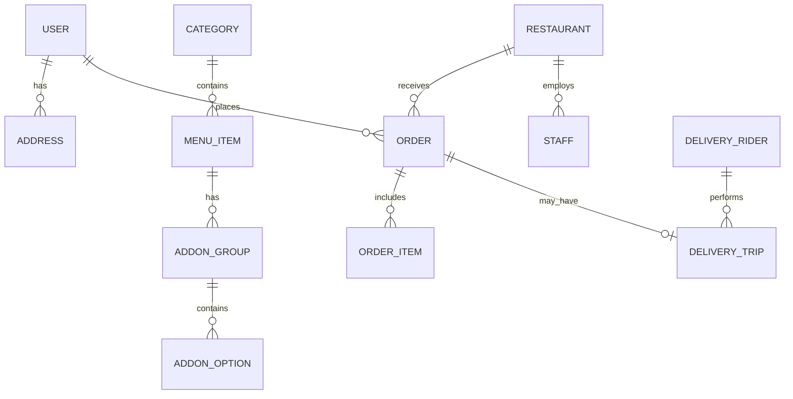

# نموذج البيانات + الصلاحيات

> هذا المستند يحدد الكيانات الأساسية (Entities) التي يحتاجها النظام، وكيفية ربطها، بالإضافة إلى نموذج صلاحيات مبسط يدعم Premium.

## الكيانات الأساسية

### User (عميل)

- `id`
- `name`
- `phone`
- `email?`
- `defaultAddressId?`
- `createdAt`

### Address

- `id`
- `userId`
- `label` (المنزل/العمل…)
- `city/area/street`
- `lat/lng` (اختياري)

### Category

- `id`
- `name`
- `sortOrder`
- `isActive`

### MenuItem

- `id`
- `categoryId`
- `name`
- `description?`
- `basePrice`
- `isActive`

### AddonGroup / AddonOption

- `AddonGroup`: (مثلاً: صوصات/أحجام)
  - `id`, `menuItemId`, `name`, `min`, `max`
- `AddonOption`:
  - `id`, `addonGroupId`, `name`, `priceDelta`

### Offer / Coupon

- `id`
- `type` (percentage/fixed/threshold/bundle)
- `rules` (JSON)
- `startAt/endAt`
- `isActive`

### Order

- `id`
- `userId`
- `restaurantId`
- `status` (راجع API.md)
- `paymentMethod` (COD/CARD/WALLET)
- `subtotal/discount/total`
- `notes?`
- `createdAt/updatedAt`

### OrderItem

- `id`
- `orderId`
- `menuItemId`
- `nameSnapshot` (حفظ الاسم وقت الطلب)
- `unitPriceSnapshot`
- `qty`
- `addonsSnapshot` (JSON)

### Restaurant

- `id`
- `name`
- `address`
- `printerConfig?`

### Staff (Premium)

- `id`
- `restaurantId`
- `name`
- `role` (ADMIN/MANAGER/CASHIER/KITCHEN…)
- `isActive`

### DeliveryRider (Premium)

- `id`
- `name`
- `phone`
- `isActive`

### DeliveryTrip (Premium)

- `id`
- `orderId`
- `riderId`
- `pickedUpAt/deliveredAt`
- `lastLocation?`

---

## العلاقات (مختصر)

---

## الصلاحيات (RBAC) — مقترح للـ Premium

- `ADMIN`: كل الصلاحيات
- `MANAGER`: إدارة المنيو + العروض + التقارير + الموظفين (بدون إعدادات حساسة)
- `CASHIER`: استقبال/تأكيد/تغيير حالات الطلب + طباعة
- `KITCHEN`: عرض الطلبات + تحديث التحضير/الجاهزية
- `RIDER`: الوصول لطلبات التوصيل المسندة له + تحديث الالتقاط/التسليم

ملاحظة: في Basic/Pro يمكن تبسيط الصلاحيات لحساب واحد للمطعم.
