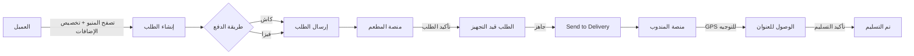

<h1 align="center">نظام إدارة المطاعم الذكي المتكامل</h1>

  
  
  

	منصة طلبات احترافية تربط بين العميل والمطعم ومندوب التوصيل — بتزامن لحظي وتجربة سلسة عبر <strong>التطبيق أو المتصفح</strong>.

	<a href="#overview">نظرة سريعة</a> •
	<a href="#modules">مكونات النظام</a> •
	<a href="#workflow">رحلة الطلب</a> •
	<a href="#features">المميزات</a> •
  <a href="#integrations">التكاملات</a>

---

## نظرة سريعة

هذا المشروع يحول المطعم من تجربة تقليدية إلى تجربة رقمية متكاملة تعتمد على التزامن اللحظي (Real‑time):

- العميل يتصفح المنيو، يخصص الأصناف (إضافات/اختيارات)، يطلب ويدفع.
- الطلب يصل للمطعم فوراً للتأكيد والتجهيز والطباعة.
- عند الجاهزية يتحول الطلب لمندوب التوصيل مع GPS حتى التسليم.

> ملاحظة: هذا المستودع حالياً يحتوي على توثيق الفكرة ووصف النظام. عند إضافة الكود لاحقاً يمكن توسيع أقسام "التشغيل" و"التثبيت".

---

## مكونات النظام

| المكوّن                     | لمن؟                   | الهدف                  | أهم ما يقدمه                                                   |
| --------------------------- | ---------------------- | ---------------------- | -------------------------------------------------------------- |
| منصة العملاء (Web/App)      | العميل                 | طلب سريع ومرن          | منيو كامل + إضافات + عروض + دفع (كاش/فيزا) + متابعة حالة الطلب |
| منصة المطعم (Web/App)       | الإدارة/الكاشير/المطبخ | استقبال وإدارة الطلبات | وصول الطلب لحظياً + تأكيد + طباعة + تحويل للدليفري             |
| منصة المندوب (Delivery App) | مندوب التوصيل          | توصيل منظم ودقيق       | استلام الطلبات + GPS + تأكيد التسليم                           |

---

## رحلة الطلب (Workflow)

### حالات الطلب المقترحة

- جديد
- تم التأكيد
- قيد التجهيز
- جاهز للتوصيل
- مع المندوب
- تم التسليم

---

## المميزات الأساسية

### تجربة العميل

- منيو كامل مع تصنيفات (Categories) حسب رغبة المطعم.
- إضافات/اختيارات لكل صنف (Add-ons) مع تسعير مستقل.
- عروض ترويجية على:
  - أصناف محددة
  - عدد معين من الأصناف
  - أو حد أدنى لإجمالي الفاتورة
- دفع مرن: كاش عند الاستلام أو فيزا/ماستر.
- تتبع حالة الطلب لحظياً حتى التسليم.

### إدارة المطعم

- استقبال الطلبات لحظياً مع بيانات العميل والعنوان والتفاصيل.
- تأكيد الطلب بزر واحد لتحديث الحالة عند العميل.
- طباعة الفاتورة عبر طابعة حرارية صغيرة (اختياري) أو التعامل اليدوي.
- تحويل الطلب لمندوب التوصيل بزر (Send to Delivery).

### تطبيق المندوب

- استلام الطلبات الجاهزة للتوصيل.
- فتح العنوان على الخريطة والتوجيه عبر GPS.
- تأكيد التسليم لإغلاق الطلب وتحديث الحالة لدى العميل والمطعم.

---

## التكاملات المقترحة

- خرائط وتوجيه: Google Maps API أو بدائلها.
- بوابات الدفع: مزود محلي/عالمي حسب بلد التشغيل.
- طابعات حرارية: دعم بروتوكولات الطباعة الشائعة حسب نوع الطابعة.
- تزامن لحظي: WebSockets / Firebase Realtime / Pusher (حسب التصميم النهائي).

---

## تقنيات مقترحة (قابلة للتغيير)

- Frontend (Web): React / Next.js
- Mobile: Flutter أو React Native
- Backend: Node.js أو Python (FastAPI/Django)
- Database: PostgreSQL أو MongoDB

---

  <strong>جاهز لتحويل مطعمك من تقليدي إلى ذكي — بتجربة طلب عبر المتصفح أو التطبيق وبمستوى عالمي.</strong>

  © 2026 eng.abdallah hany — جميع الحقوق محفوظة.

